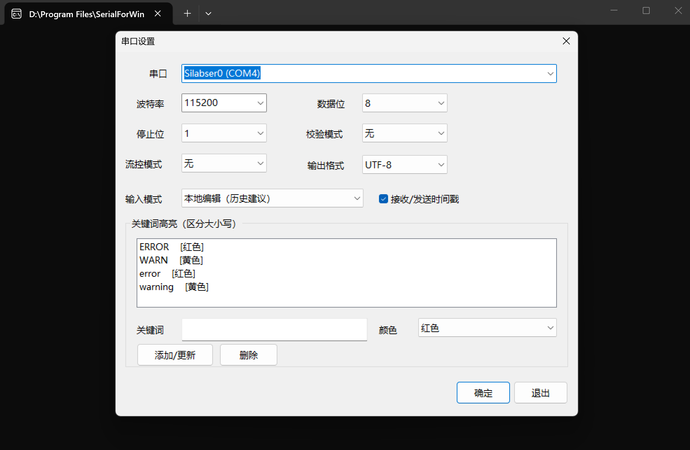

# SerialPortForWindowsTerminal
Serial port for windows terminal, 让Windows Terminal支持串口的插件

该插件为WindowsTerminal提供访问串口终端能力


## 使用说明


## 配置说明：



截图为示例配置，串口号和关键词高亮规则以本机设置为准。

### 关键词高亮

「串口设置」中的「关键词高亮」用于标记串口接收内容。默认规则为 `ERROR` 使用红色、`WARN` 使用黄色。

- 每条规则包含一个关键词和一种预置颜色，可添加、更新或删除。
- 预置颜色包括红色、黄色、绿色、青色、蓝色和品红。
- 关键词按完整字面量匹配并区分大小写，不支持正则表达式。
- 高亮只影响 Windows Terminal 显示，不修改串口接收数据或用户发送内容。
- 关键词按当前选择的 UTF-8 或 GBK 编码匹配。

### 日志时间戳

「串口设置」中的「接收/发送时间戳」默认开启，也可按 `Ctrl+A` 后再按 `Ctrl+T` 切换。

- 接收日志按行显示电脑本地时间，格式为 `[HH:mm:ss.fff]`；时间取该行首批数据到达电脑的时刻，不代表设备产生日志的时刻
- 一行分多次收到时只加一次时间戳，不等待换行才显示；`CRLF`、`LF`、`CR` 均按换行显示，空行不加时间戳
- 本地编辑模式发送的命令显示为 `[HH:mm:ss.fff] > 命令`，外部控制命令保留 `[TX External]` 来源标记；时间取串口写队列开始发送的时刻，尚不计算执行耗时
- 本地手动输入的非空命令保留青色发送记录及发送时间；发送后 1 秒内，若首条接收行与命令逐字节一致，则隐藏这一条设备回显及其换行。支持跨串口分包匹配；失配、超时、切换模式或再次发送时，尚未匹配完整的内容正常显示，不继续搜索后续同名日志
- 本地输入为空时按回车，只发送一个 `CR`（`\r`），并显示青色的 `[HH:mm:ss.fff] >` 发送记录（关闭时间戳时只显示 `>`）。空命令不做回显过滤，设备返回的空行和新提示符继续显示，可用于分隔输出，并记录这次空回车的发送时间；出现空行不代表重复发送了回车
- 串口没有独立的回显标记：如果设备关闭了回显，而首条实际输出恰好与命令完全相同，也会按回显隐藏。字符透传和外部控制命令不启用此显示过滤
- 时间戳只加入显示内容；串口数据和 `SerialTerminalCtl.exe` 返回的原始响应不受影响

### 输入历史与灰色建议

在「输入模式」中选择「本地编辑（历史建议）」，或按 `Ctrl+A` 后再按 `Ctrl+E` 从字符透传切换。已有的「回显模式」配置继续用于选择这两种输入方式。

本地编辑时，输入行固定在终端底部，上方日志持续滚动。输入只在按回车后整行发送，末尾只追加一个 `CR`（`\r`），避免设备 shell 将 `CRLF` 当成两次提交；输入前缀匹配历史命令时，剩余内容以灰色显示。

| 按键 | 操作 |
| --- | --- |
| `→` / `Ctrl+F` | 光标在行末时接受灰色建议，否则向右移动 |
| `Tab` | 接受历史建议；不查询设备文件或补全设备命令 |
| `↑` / `↓` | 按当前前缀翻阅历史；回到最新位置时恢复草稿 |
| `←` / `→`、`Home` / `End` | 移动光标 |
| `Backspace` / `Delete` | 删除光标前 / 后的字符 |
| `Ctrl+U` / `Ctrl+K` / `Ctrl+W` | 删除光标前内容 / 光标后内容 / 前一个词 |
| `Ctrl+C` | 清空草稿，同时向设备发送中断字符 |
| `Ctrl+D` | 空输入时向设备发送 EOF 字符，否则删除光标后的字符 |

- 历史保存到 `%LOCALAPPDATA%\SerialForWindowsTerminal\history.txt`，使用 UTF-8，每行一条，保留最近 500 条不同命令；重复命令移到最近位置
- 只记录本地编辑后成功写入串口的非空单行命令；以空格开头的命令不记录，字符透传和外部控制输入不记录
- 历史在发送后保存，重新启动后可用；多个窗口保存时合并历史，旁边的 `history.txt.lock` 用于写入互斥
- 单条本地输入最多 4096 个 UTF-16 代码单元；支持 UTF-8、GBK 输入及中文字符编辑；长输入在底部水平滚动
- Windows Terminal 的括号粘贴模式下，粘贴换行转为空格，回车确认后才发送
- 本地编辑用于命令输入和日志查看：接收内容保留 ANSI 颜色，忽略光标定位、清屏和标题等控制序列，避免覆盖输入行
- 登录密码、`vim`、`top` 等直接交互使用「字符透传」，并关闭时间戳；此时按原有方式转发字符和终端控制序列
- 串口参数、时间戳开关、输入模式及高亮规则仍保存在 `HKEY_CURRENT_USER\SOFTWARE\SerialForWindowsTerminal`

清空持久历史时，先退出所有串口终端窗口，再删除 `history.txt`；下次启动会以空历史开始。历史读写失败时终端会显示错误，已有文件不会被损坏内容覆盖。

### 外部命令控制

串口连接成功后，主程序会启动仅限本机访问的命名管道 `\\.\pipe\SerialForWindowsTerminal`。Codex、脚本或测试程序可使用同目录下的 `SerialTerminalCtl.exe` 发送命令并读取响应：

```powershell
.\SerialTerminalCtl.exe exec --line-ending cr "cd /customer"
.\SerialTerminalCtl.exe exec --line-ending cr --prompt "# " "ls -l"
```

外部输入会以 `[TX External] > 命令` 的形式显示在串口终端中，设备响应仍实时显示并应用关键词高亮；控制程序同时从标准输出返回未高亮、未加入时间戳的 UTF-8 文本。外部命令执行期间，普通键盘输入不会写入串口，本地草稿保留。

控制参数：

- `--prompt <文本>`：响应以指定提示符结尾时完成。
- `--idle <毫秒>`：收到响应后持续无新数据即完成，默认 `300`。
- `--timeout <毫秒>`：命令总超时，默认 `5000`。
- `--line-ending <类型>`：发送命令使用 `none`、`cr`、`lf` 或 `crlf`，默认 `crlf`；连接 Linux shell 时显式使用 `--line-ending cr`，避免多提交一次空行

提示符匹配和空闲时间任一条件满足即视为成功；总超时返回退出码 `2`，通信等错误返回退出码 `3`，参数不正确时显示用法并返回 `64`（当前 `--help` 也按此方式处理）。同一时间只处理一个外部连接。若启动了多个串口终端实例，只有成功创建固定命名管道的实例可接受外部命令。

### 串口断开与关闭终端

- 串口接收失败时显示错误码、错误原因和重新打开终端的提示，以非零退出码结束；错误原因按终端当前的 UTF-8 / GBK 编码显示。Windows Terminal 默认的 `closeOnExit: automatic` 会保留错误页，已有接收内容可继续查看
- 不自动重连；重新插入串口后重新打开该配置连接。显式配置 `closeOnExit: always` 时，Terminal 仍会关闭错误页
- 点击标签页关闭按钮时，程序接管控制台关闭通知，取消串口和输入输出操作，停止外部控制线程后退出；清理等待最多 3 秒，超时后交由系统结束进程
- 控制台关闭处理在串口设置对话框结束后重新注册，避免输入法组件卸载后留下的控制台回调被继续调用

### 构建与验证

沿用 Visual Studio 2019 C++ 工具集（`v142`）、Windows SDK 和上级目录的 `boost_1_68_0`。可用 `BoostRoot` 指定 Boost 目录。

```powershell
msbuild SerialForWindowsTerminal.sln /t:Rebuild /m /p:Configuration=Release /p:Platform=x64
msbuild tests\TerminalInteractionTests.vcxproj /t:Rebuild /m /p:Configuration=Release /p:Platform=x64
$testDirectory = Join-Path $PWD ('artifacts\tests\run-' + [guid]::NewGuid().ToString('N'))
New-Item -ItemType Directory -Path $testDirectory | Out-Null
.\artifacts\tests\x64\TerminalInteractionTests.exe (Join-Path $testDirectory 'history.txt')
```

自动检查覆盖串口分包、换行、UTF-8/GBK、ANSI 颜色、关键词高亮、历史恢复与并发保存、灰色建议、草稿恢复、中文编辑及粘贴。回车检查以字节管道代替串口，经过实际输入处理和发送队列，确认命令与空行均只发送一个 `CR`。断开检查覆盖错误提示、非零错误状态、主动取消与排队写入取消。测试使用独立历史文件，不访问实际设备。测试程序的 `--preview` 参数可显示持续模拟日志和输入建议，用于 Windows Terminal 视觉检查。
